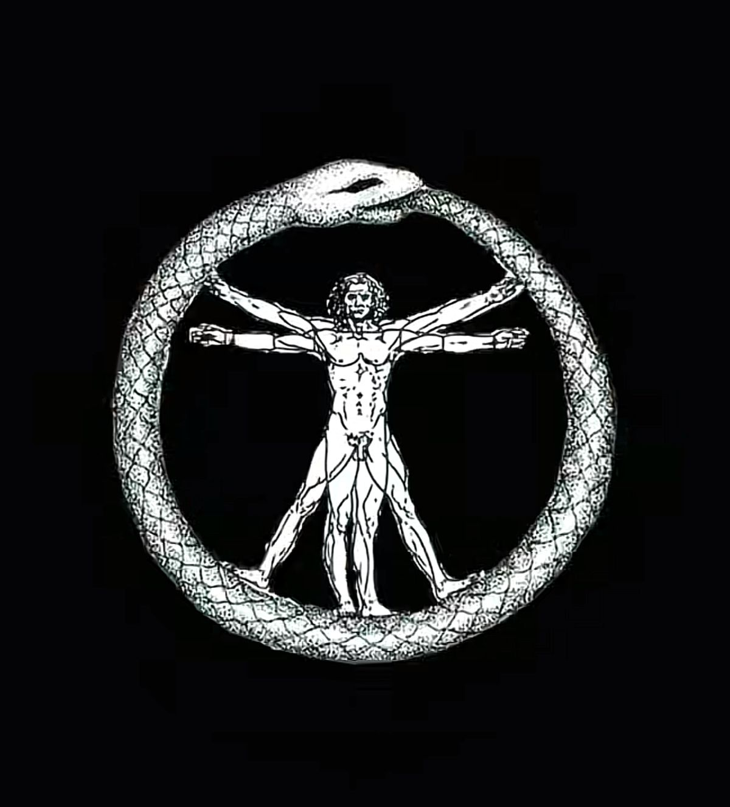
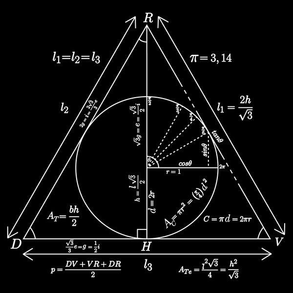

<div align="center">


<a href="https://github.com/kaike-elK">
  
</a>

<br/>



</div>

<br/>

```text
┌──────────────────────────────────────────────┐
│  $ whoami                                    │
│  > kaike                                    │
│                                              │
│  $ cat sobre.txt                             │
│  > Dev que enxerga estrutura em tudo:        │
│  > da proporção áurea ao algoritmo,          │
│  > do pixel à arquitetura do sistema.        │
│                                              │
│  $ status                                    │
│  > aprendendo · construindo · evoluindo      │
└──────────────────────────────────────────────┘
```

<br/>

## `// anatomia`

<div align="center">



</div>

- 🔭 Trabalhando em: **seu projeto atual aqui**
- 🌱 Estudando: **tecnologias que você está aprendendo**
- 🧩 Curioso por: **temas que te prendem a atenção**
- 💬 Pergunte-me sobre: **o que você domina**
- 📫 Contato: **seu email / linkedin**

<br/>

## `// stack`

<div align="center">


</div>

<br/>

## `// métricas`

<div align="center">


<br/>


</div>

<br/>

## `// sistema`

<div align="center">


</div>

<br/>

<div align="center">

```text
"tudo é número, tudo é padrão, tudo é código."
```

<br/>


<br/>


</div>
